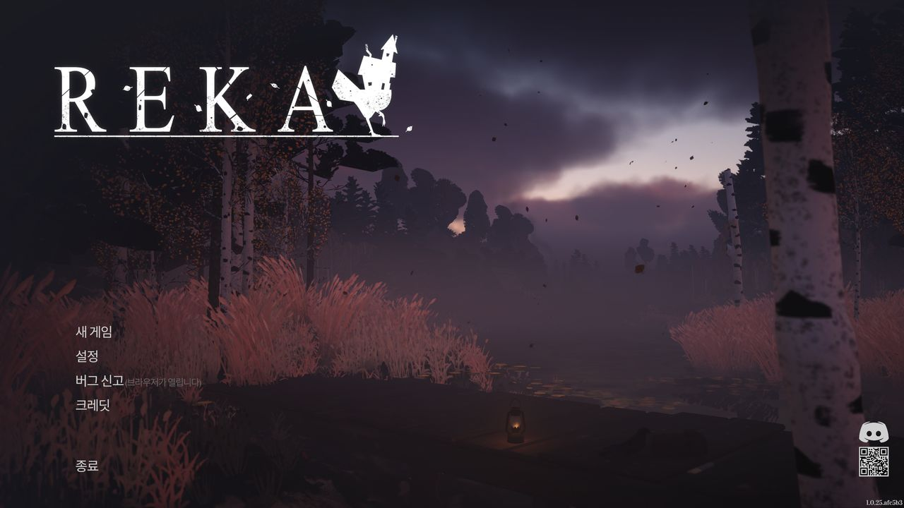
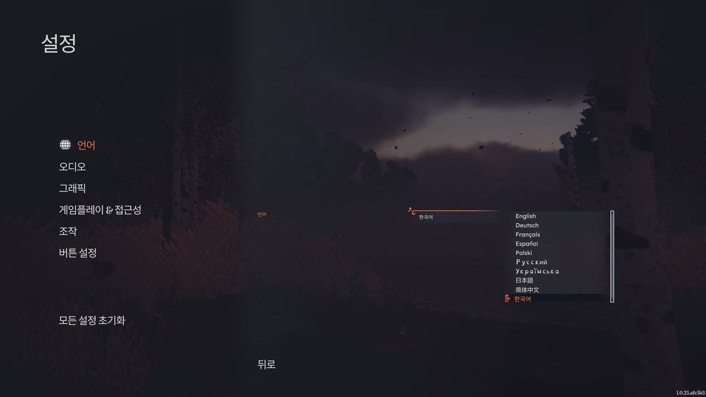
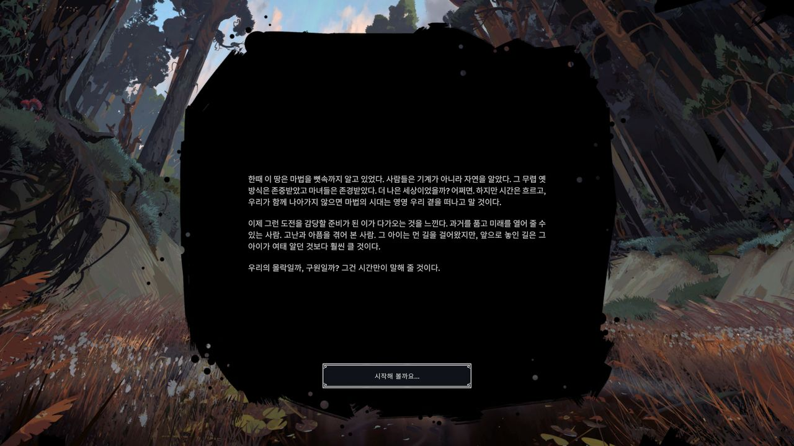
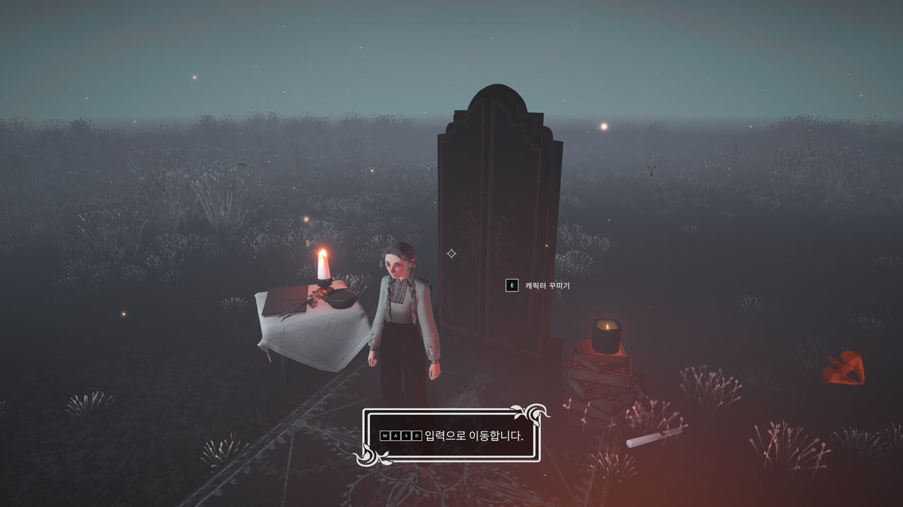
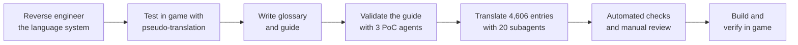
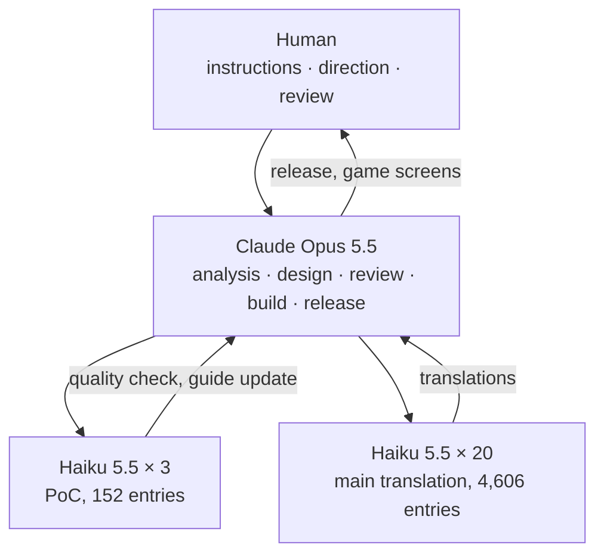
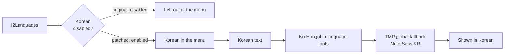

<div align="center">

[한국어](README.md) | **English**

# 🐔 REKA Korean Patch

Wakes up the empty Korean language slot in **REKA** and translates the whole game

[](https://github.com/game-patch-ko/reka-ko/releases)
[](RELEASES.md)
[](RELEASES.md)
[](#-how-it-works)
[](#-quick-install)

[**Download**](https://github.com/game-patch-ko/reka-ko/releases) · [Quick install](#-quick-install) · [How it works](#-how-it-works) · [Build from source](#-build-from-source) · [Release history](RELEASES.md)



</div>

## ✨ Features

| | |
|---|---|
| 🌐 **No language is lost** | English, Chinese and the others stay in place. Korean is added as a regular entry in the language menu. |
| 📝 **Full translation** | 4,758 entries: dialogue, journal, items, buildings, tutorials and UI. |
| 🎭 **Character voices** | Baba Jaga's seasoned informal speech, Reka's polite speech and inner monologue, and the villagers and animals each have their own register. |
| 🔤 **Korean font included** | Adds a dynamic Noto Sans KR font and turns on word-based Hangul line breaking. |
| 🪶 **Lightweight** | Only `resources.assets` changes, and the zip is 8.4 MB. |
| 📦 **Overwrite install** | Unzip and overwrite the game folder. No extra program is needed. |

## 🖼️ Screenshots

<table>
  <tr>
    <td></td>
    <td></td>
  </tr>
  <tr>
    <td align="center">Language menu with every other language kept</td>
    <td align="center">Game intro</td>
  </tr>
  <tr>
    <td colspan="2"></td>
  </tr>
  <tr>
    <td colspan="2" align="center">Tutorial prompt with key icons</td>
  </tr>
</table>

## 🏆 What was done: from an empty slot to a finished Korean version

The game has **a hidden Korean language slot, but not a single line of translation inside it.** With nothing to evaluate or keep, the slot was opened properly and the whole game was translated from scratch.

### State of the game

| Area | Found | Done |
|---|---|---|
| 🔒 **Access** | The `Korean` slot in I2 Localization is flagged Disabled, so the language menu skips it | Cleared the flag to enable it as a regular language |
| 📭 **Translation** | 0 entries in the `Korean` slot | Translated 4,758 entries |
| 🏷️ **Menu label** | Dropdown labels come from a fixed list in a prefab, so the 10th row reads `Display Localization Keys` | Changed that developer-only term to `한국어` in every language |
| 🔤 **Font** | The per-language fonts have no Hangul, and font copies are spread over large bundles | Put a Korean font in place of an unused sample font and registered it as the global fallback |
| ↩️ **Line breaks** | Word-based Hangul line breaking is off | Enabled it in the TMP settings |

### Examples fixed during QA

| Source | Before | After | Why |
|---|---|---|---|
| `Aniya` | **아니야** | **아니아** | The name read like the Korean word for "no" |
| `Wolfsbane` | **늑대독초** | **투구꽃** | Unified on the real plant name |
| `Spirit Jar` | 정령 단지, 영혼 병 | **영혼 단지** | Unified the spelling |
| `Loading Game Assets...` | 게임 **자산**을 불러오는 중... | 게임 **데이터**를 불러오는 중... | Fixed a literal dev-term translation |
| `Tap {action:Place} ... hold {action:Place}` | One variable missing | Both variables kept | Key hints must stay complete |

### Process



- **Finding hardcoded text:** the game was run with a `한글` marker in front of every string, to reveal text that bypasses the translation data. From the menus to the tutorial, key names were the only exception in the areas checked.
- **Structure:** variables, tags, line counts, edge spaces and leftover Latin or Han characters are compared with the source for each entry.
- **Terms and voice:** glossary use, identical-source consistency and per-speaker rules are checked by tools, and the results were reviewed by hand.
- **Dialogue beats:** line breaks in dialogue map one-to-one to emotion cues, so the line count always matches the source.
- **Other languages:** their translations are not changed, except for the one developer-only term used as the menu label.

> [!NOTE]
> In-game verification covers the main menu, settings, language menu, key mapping, intro, character customization and the first tutorial prompts. The story was not played to the end, and the NPC dialogue box has not been checked on screen yet.

## 🤖 How it was made: a human-directed AI harness

This patch was made by **a person setting the working instructions, Opus 5.5 leading the whole job in the AI harness [Claude Code](https://claude.com/claude-code), and Haiku 5.5 subagents doing the translation.**



| Role | Who | Work |
|---|---|---|
| 🧑 **Direction** | Human | Set the language policy, release format and subagent setup. Checked the game and flagged wording |
| 🧠 **Lead** | Claude Opus 5.5 | Reverse engineering, patch, glossary and guide, QA, build, verification, release |
| ✍️ **Translation** | Claude Haiku 5.5 (medium) | Validated the guide with 3 PoC agents, then 20 ran in parallel |

AI output was not used as it came. Tools verified structure and consistency, Opus 5.5 compared flagged entries and random samples with the source and fixed them, and the result was checked on real game screens.

REA was used for analysis. `GameAssembly.dll` is 112 MB and a full Ghidra analysis timed out, so an IL2CPP metadata parser and a targeted disassembly tool were written to analyze the language list code.

## 🚀 Quick install

1. Close the game.
2. Download the zip from [Releases](https://github.com/game-patch-ko/reka-ko/releases) and unzip it.
3. Overwrite the game folder with the `Reka_Data` folder.
   - In your Steam library, right-click the game → **Manage** → **Browse local files**
4. Start the game. If Steam is set to Korean it is selected automatically. Otherwise pick **한국어** under **Settings → Language**.

> [!IMPORTANT]
> This patch is for **Steam build 26298851** (game 1.0.25) only. On another build the game may not start.

> [!TIP]
> To remove it, right-click the game in Steam → **Properties → Installed Files → Verify integrity of game files**.

## 🔍 How it works

The language menu lists the I2 Localization languages that are not disabled. The patch adds Korean to that flow and draws the glyphs through TextMeshPro's global fallback.



| Target (`Reka_Data/resources.assets`) | Change |
|---|---|
| `I2Languages` | Clear the Korean Disabled flag, add the text, change the menu label term |
| `Roboto-Bold SDF`, `Roboto-Bold` | Replace this unused TMP sample font with a dynamic Noto Sans KR font |
| `TMP Settings` | Register that font as global fallback, turn on `m_UseModernHangulLineBreakingRules` |

<details>
<summary><b>Reverse engineering details</b></summary>

- Text data: `LanguageSourceAsset` `I2Languages`, 17 columns (languages and notes), Korean at index 11.
- Language list: `LocalizationSettings.RefreshLanguages` calls `GetAllLanguages(SkipDisabled=true)` and filters with `IsHiddenByBuild`, which does not cover Korean.
- Dropdown labels: a fixed list in a prefab, separate from the language list, so the 10th row, where Korean lands, shows `UI/MainMenu/Settings/Language/DisplayLocalizationKeys`.
- Fonts: bundles carry their own font copies, and patching them would mean rebuilding an 819 MB bundle. `m_fallbackFontAssets` in `TMP Settings` is empty and applies to all text, so the font is registered there.
- A second `I2Languages` copy lives in the `scriptableobjects` bundle, but patching the Resources copy alone was confirmed to work in game.

</details>

## 🛠️ Build from source

<details>
<summary><b>Show build steps</b></summary>

Install the game and prepare the following. The font and the game files are not in this repository.

| Requirement | Details |
|---|---|
| Python packages | `UnityPy`, `fonttools`, `TypeTreeGeneratorAPI` |
| `fonts/NotoSansCJKkr-Regular.otf` | Source font from [Noto CJK](https://github.com/notofonts/noto-cjk) |

Set the `REKA_GAME` environment variable if the game is elsewhere. Run these from the repository root.

```bash
python -X utf8 tools/extract.py
```

```bash
python -X utf8 tools/check.py
```

```bash
python -X utf8 tools/patch.py
```

The result is written to `work/out/Reka_Data/resources.assets`.

When the game updates, recheck the path ids in `tools/patch.py` and use `tools/check.py` to find new entries to translate.

</details>

## 📁 Repository layout

```text
├── docs/images/    README screenshots
├── tools/          analysis, extraction, checks, build and release scripts
├── translations/
│   ├── ko.json         Korean text by term key
│   ├── glossary.json   glossary
│   └── GUIDE.md        translation guide
├── LICENSE         license for the tools (MIT)
├── LICENSE-translations  license for the translation (CC0 1.0)
├── NOTICE.md       rights notice and third-party components
└── RELEASES.md     release history and file hashes
```

Game files and build output are not stored here. Build output is kept as Release attachments.

## ⚖️ Rights and notes

- **Purpose:** this patch was made purely as a fan project for Korean fans of REKA. It is non-commercial and free of charge.
- **Rights:** all rights to the original game belong to Emberstorm Entertainment. This patch is unofficial and not approved by the developer. The author claims no exclusive rights over this patch.
- **Withdrawal:** the patch may be taken down if the original developer requests it.
- **Updates:** the author is an ordinary office worker, so responses may be slow when a game update or similar change breaks the patch. Thank you for your understanding.

- **License:** the code in `tools/` is under [MIT](LICENSE) and the Korean text in `translations/` is under [CC0 1.0](LICENSE-translations). CC0 covers the author's own contribution only and grants no rights to the original game.

See [NOTICE.md](NOTICE.md) for details, including third-party components.
