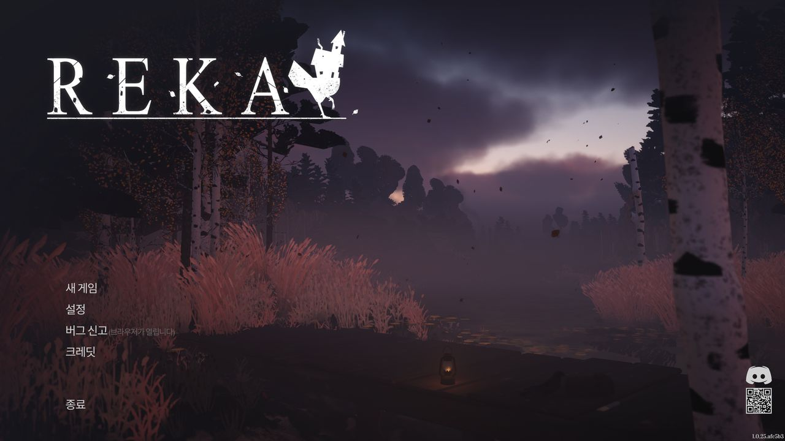
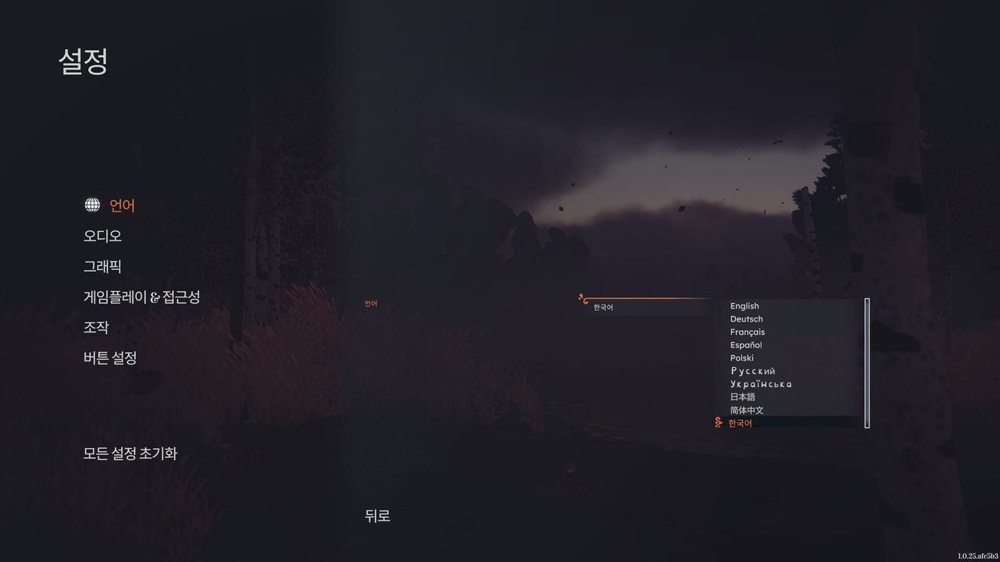
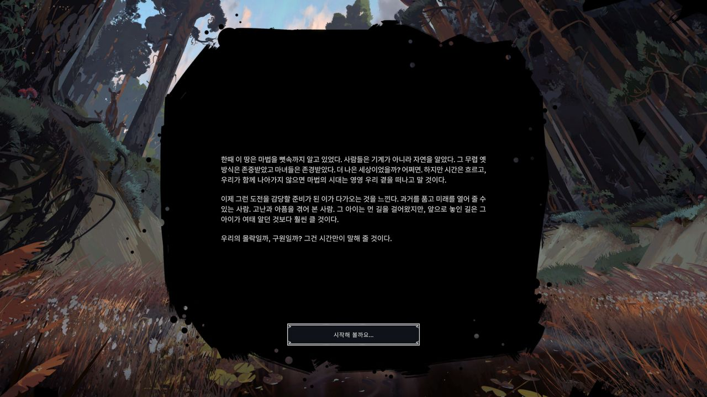
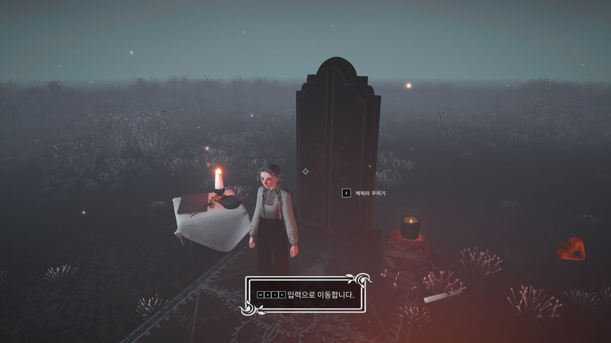
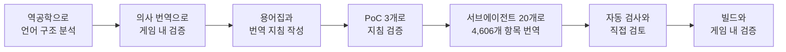
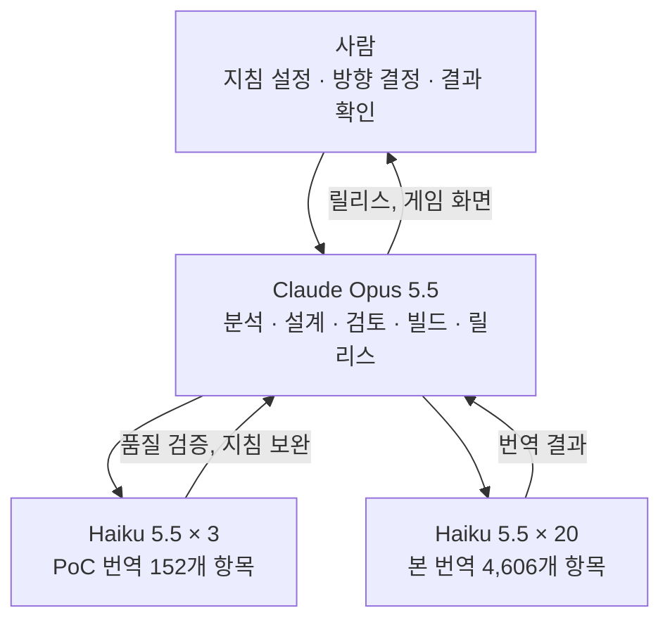
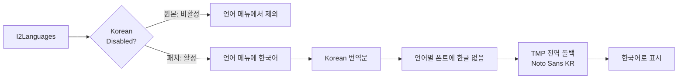

<div align="center">

**한국어** | [English](README.en.md)

# 🐔 REKA 한국어 패치

**REKA**의 비어 있던 한국어 언어 칸을 깨우고, 게임 전체를 새로 번역한 패치

[](https://github.com/game-patch-ko/reka-ko/releases)
[](RELEASES.md)
[](RELEASES.md)
[](#-어떻게-동작하나요)
[](#-빠른-설치)

[**다운로드**](https://github.com/game-patch-ko/reka-ko/releases) · [빠른 설치](#-빠른-설치) · [동작 원리](#-어떻게-동작하나요) · [직접 빌드](#-직접-빌드) · [릴리스 기록](RELEASES.md)



</div>

## ✨ 특징

| | |
|---|---|
| 🌐 **언어를 잃지 않습니다** | 영어나 중국어 자리를 덮어쓰지 않습니다. 한국어가 언어 메뉴의 정식 항목으로 추가됩니다. |
| 📝 **게임 전체 번역** | 대사, 일지, 아이템, 건축물, 튜토리얼, UI까지 4,758개 항목을 번역했습니다. |
| 🎭 **인물별 말투** | 노련한 바바 야가의 반말, 레카의 해요체와 혼잣말, 마을 사람과 동물의 개성을 구분했습니다. |
| 🔤 **한글 폰트 내장** | Noto Sans KR 동적 폰트를 넣고 한글 단어 단위 줄바꿈을 켰습니다. |
| 🪶 **가벼운 패치** | 바뀌는 파일은 `resources.assets` 하나이고 zip은 8.4MB입니다. |
| 📦 **덮어쓰기 설치** | 압축을 풀어 게임 폴더에 덮어쓰면 끝입니다. 별도 프로그램이 필요 없습니다. |

## 🖼️ 스크린샷

<table>
  <tr>
    <td></td>
    <td></td>
  </tr>
  <tr>
    <td align="center">다른 언어를 유지한 언어 설정</td>
    <td align="center">게임 도입부</td>
  </tr>
  <tr>
    <td colspan="2"></td>
  </tr>
  <tr>
    <td colspan="2" align="center">키 아이콘이 함께 나오는 튜토리얼 안내</td>
  </tr>
</table>

## 🏆 한 일: 빈 언어 칸에서 완성된 한국어까지

이 게임에는 **한국어 언어 칸이 있지만 숨겨져 있었고, 안에는 번역이 한 줄도 없었습니다.** 평가해서 살릴 번역이 없었으므로, 언어 칸을 정식으로 열고 게임 전체를 새로 번역했습니다.

### 발견 당시의 상태

| 구분 | 발견한 상태 | 처리 |
|---|---|---|
| 🔒 **접근** | I2 Localization의 `Korean` 칸에 Disabled 플래그가 켜져 언어 메뉴에서 제외됨 | 플래그를 꺼서 정식 언어로 활성화 |
| 📭 **기존 번역** | `Korean` 칸의 내용 0건 | 4,758개 항목을 새로 번역 |
| 🏷️ **메뉴 이름** | 언어 드롭다운 이름이 프리팹의 고정 목록이라 10번째 칸이 `Display Localization Keys`로 표시됨 | 이 개발용 용어를 모든 언어에서 `한국어`로 변경 |
| 🔤 **폰트** | 언어별 폰트에 한글이 없고, 폰트 사본이 큰 번들마다 흩어져 있음 | 쓰이지 않는 예제 폰트 자리에 한글 폰트를 넣고 전역 폴백으로 등록 |
| ↩️ **줄바꿈** | 한글 단어 단위 줄바꿈이 꺼져 있음 | TMP 설정에서 활성화 |

### 품질 검사에서 바로잡은 사례

| 원문 | 수정 전 | 수정 후 | 이유 |
|---|---|---|---|
| `Aniya` | **아니야** | **아니아** | 인물 이름이 부정어처럼 읽힘 |
| `Wolfsbane` | **늑대독초** | **투구꽃** | 실제 식물명으로 통일 |
| `Spirit Jar` | 정령 단지, 영혼 병 | **영혼 단지** | 표기 통일 |
| `Loading Game Assets...` | 게임 **자산**을 불러오는 중... | 게임 **데이터**를 불러오는 중... | 개발 용어 직역 수정 |
| `Tap {action:Place} ... hold {action:Place}` | 변수 1개 누락 | 변수 2개 유지 | 키 안내 정합성 |

### 작업 과정



- **하드코딩 탐지:** 모든 문자열 앞에 `한글` 표식을 붙인 의사 번역으로 게임을 실행해, 번역 데이터를 거치지 않는 문자열을 찾았습니다. 메뉴부터 튜토리얼까지 확인한 범위에서 예외는 키 이름뿐이었습니다.
- **구조 정합성:** 변수, 태그, 줄바꿈 수, 앞뒤 공백, 남은 영어와 한자를 항목마다 원문과 대조합니다.
- **용어와 말투:** 용어집 준수, 동일 원문의 번역 일치, 화자별 말투 규칙을 도구로 검사하고 결과를 직접 검토했습니다.
- **대사 단위 보존:** 대사의 줄바꿈은 감정 연출과 1:1로 대응하므로 줄 수를 원문과 똑같이 유지합니다.
- **다른 언어 보호:** 다른 언어 칸의 번역은 바꾸지 않습니다. 예외는 언어 메뉴 이름으로 쓰는 개발용 용어 하나입니다.

> [!NOTE]
> 게임 내 검증은 메인 메뉴, 설정, 언어 메뉴, 키 설정, 도입부, 캐릭터 꾸미기, 첫 튜토리얼 안내까지입니다. 스토리 전체를 끝까지 플레이해 확인한 것은 아니며, NPC 대사창은 아직 화면으로 확인하지 못했습니다.

## 🤖 작업 방식: 사람이 지휘한 AI 하네스

이 패치는 **사람이 작업 지침을 정하고, AI 하네스 [Claude Code](https://claude.com/claude-code)에서 Opus 5.5가 전체를 이끌며, 번역에 Haiku 5.5 서브에이전트를 투입해** 만들었습니다.



| 역할 | 담당 | 한 일 |
|---|---|---|
| 🧑 **작업 지휘** | 사람 | 언어 처리 원칙, 패치 배포 방식, 서브에이전트 구성 등 작업 지침 설정. 게임 내 결과 확인과 표현 지적 |
| 🧠 **총괄** | Claude Opus 5.5 | 역공학 분석, 패치 구현, 용어집과 번역 지침 작성, 품질 검사, 빌드와 검증, 릴리스 |
| ✍️ **번역** | Claude Haiku 5.5 (medium) | PoC 3개로 지침을 검증한 뒤 20개가 병렬로 번역 |

AI가 낸 결과를 그대로 쓰지 않았습니다. 번역은 도구로 구조와 일관성을 검증했고, 지적된 항목과 무작위 표본은 Opus 5.5가 원문과 대조해 고쳤습니다. 마지막에는 실제 게임 화면으로 확인했습니다.

분석에는 REA를 썼습니다. `GameAssembly.dll`은 112MB로 Ghidra 전체 분석이 시간 초과되어, IL2CPP 메타데이터 파서와 대상 함수 디스어셈블리 도구를 직접 작성해 언어 목록 코드를 분석했습니다.

## 🚀 빠른 설치

1. 게임을 종료합니다.
2. [릴리스](https://github.com/game-patch-ko/reka-ko/releases)에서 zip을 내려받아 압축을 풉니다.
3. `Reka_Data` 폴더를 게임 폴더에 덮어씁니다.
   - Steam 라이브러리에서 게임 우클릭 → **관리** → **로컬 파일 보기**
4. 게임을 실행합니다. Steam 언어가 한국어이면 자동으로 선택됩니다. 아니면 **Settings → Language**에서 **한국어**를 고릅니다.

> [!IMPORTANT]
> 이 패치는 **Steam build 26298851**(게임 1.0.25) 전용입니다. 다른 빌드에 덮어쓰면 실행되지 않을 수 있습니다.

> [!TIP]
> 제거하려면 Steam에서 게임 우클릭 → **속성 → 설치된 파일 → 게임 파일 무결성 검사**를 실행합니다.

## 🔍 어떻게 동작하나요

게임의 언어 메뉴는 I2 Localization에서 비활성이 아닌 언어를 가져옵니다. 패치는 이 흐름에 한국어를 넣고, 글자는 TextMeshPro의 전역 폴백으로 표시합니다.



| 대상 (`Reka_Data/resources.assets`) | 변경 내용 |
|---|---|
| `I2Languages` | Korean 칸의 Disabled 플래그 해제, 번역문 입력, 언어 메뉴 이름 용어 변경 |
| `Roboto-Bold SDF`, `Roboto-Bold` | 게임이 쓰지 않는 TMP 예제 폰트를 Noto Sans KR 동적 폰트로 교체 |
| `TMP Settings` | 위 폰트를 전역 폴백으로 등록, `m_UseModernHangulLineBreakingRules` 켜기 |

<details>
<summary><b>역공학 상세</b></summary>

- 번역 데이터: `LanguageSourceAsset` `I2Languages`, 언어 슬롯 17칸(언어와 메모 칼럼), Korean은 인덱스 11입니다.
- 언어 목록: `LocalizationSettings.RefreshLanguages`가 `GetAllLanguages(SkipDisabled=true)`로 받은 뒤 `IsHiddenByBuild`로 거릅니다. 한국어는 이 필터의 대상이 아닙니다.
- 드롭다운 이름: 언어 목록과 별개인 프리팹의 고정 목록을 쓰므로, 한국어가 들어가는 10번째 칸은 `UI/MainMenu/Settings/Language/DisplayLocalizationKeys`를 표시합니다.
- 폰트: 번들이 각자 폰트 사본을 갖고 있어 사본을 고치면 819MB 번들까지 다시 만들어야 합니다. `TMP Settings`의 `m_fallbackFontAssets`는 비어 있고 모든 텍스트에 적용되므로 이곳에 등록했습니다.
- `I2Languages`의 다른 사본이 `scriptableobjects` 번들에도 있지만, Resources의 사본만 고쳐도 동작함을 게임에서 확인했습니다.

</details>

## 🛠️ 직접 빌드

<details>
<summary><b>빌드 방법 펼치기</b></summary>

게임을 설치하고 다음을 준비합니다. 폰트와 게임 원본은 저장소에 없습니다.

| 준비물 | 내용 |
|---|---|
| Python 패키지 | `UnityPy`, `fonttools`, `TypeTreeGeneratorAPI` |
| `fonts/NotoSansCJKkr-Regular.otf` | [Noto CJK](https://github.com/notofonts/noto-cjk)의 원본 폰트 |

게임 위치가 다르면 환경 변수 `REKA_GAME`을 지정합니다. 저장소 루트에서 차례로 실행합니다.

```bash
python -X utf8 tools/extract.py
```

```bash
python -X utf8 tools/check.py
```

```bash
python -X utf8 tools/patch.py
```

결과는 `work/out/Reka_Data/resources.assets`에 생깁니다.

게임이 업데이트되면 `tools/patch.py`의 path id를 다시 확인하고, `tools/check.py`로 새 항목을 찾아 번역합니다.

</details>

## 📁 저장소 구성

```text
├── docs/images/    README 스크린샷
├── tools/          분석, 추출, 검증, 빌드, 릴리스 스크립트
├── translations/
│   ├── ko.json         용어 키별 한국어 번역
│   ├── glossary.json   용어집
│   └── GUIDE.md        번역 지침
├── LICENSE         도구 코드 라이선스 (MIT)
├── LICENSE-translations  번역문 라이선스 (CC0 1.0)
├── NOTICE.md       권리 고지와 서드파티 구성 요소
└── RELEASES.md     릴리스 기록과 파일 해시
```

게임 원본과 빌드 결과물은 저장소에 넣지 않습니다. 결과물은 Release 첨부로 보관합니다.

## ⚖️ 권리와 안내

- **제작 목적:** 이 패치는 REKA를 좋아하는 한국 팬들을 위해 순수한 팬의 입장에서 만들었습니다. 상업적 목적이 없으며 무료로 제공합니다.
- **권리:** 원작의 모든 권리는 Emberstorm Entertainment에 있습니다. 이 패치는 비공식이며 제작사의 승인을 받지 않았습니다. 제작자는 이 패치에 대해 어떠한 배타적 권리도 주장하지 않습니다.
- **제공 중단:** 원 게임 제작사가 요구할 경우 패치 제공을 중단할 수 있습니다.
- **업데이트 대응:** 제작자는 직장을 다니는 평범한 직장인입니다. 게임 업데이트 등으로 패치가 작동하지 않을 때 대응이 늦을 수 있으니 양해 부탁드립니다.

- **라이선스:** `tools/`의 코드는 [MIT](LICENSE), `translations/`의 한국어 텍스트는 [CC0 1.0](LICENSE-translations)입니다. CC0는 제작자의 기여분에만 적용되며 원작에 대한 어떤 권리도 부여하지 않습니다.

서드파티 구성 요소를 포함한 자세한 내용은 [NOTICE.md](NOTICE.md)를 보세요.
